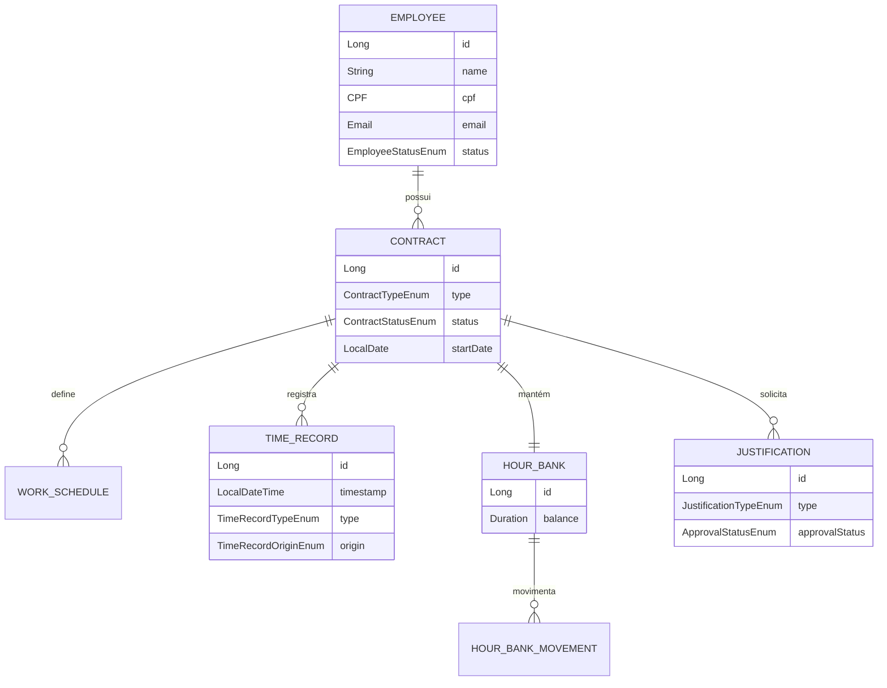

# ⏱️ Sistema de Controle de Ponto Eletrônico (Lab 07)


Sistema corporativo de **Controle de Ponto Eletrônico e Banco de Horas** desenvolvido em grupo com foco em **Clean Code**, modelagem rica de domínio (**DDD** / *Value Objects*) e arquitetura em camadas utilizando **Java 21** e **Spring Boot**.

---

## 🎯 Problemas Solucionados

A aplicação gerencia todo o ciclo de jornada de trabalho de colaboradores de uma empresa:

- **Registro de Ponto (`TimeRecord`):** Horários de entrada, pausa, retorno e saída com rastreamento de origem (Web, Mobile, Biometria).
- **Gestão de Contratos e Escalas (`Contract` & `WorkSchedule`):** Controle de vínculo contratual (CLT, Estágio, PJ) e jornadas por dia da semana.
- **Banco de Horas (`HourBank` & `HourBankMovement`):** Apuração automática de saldo, créditos de horas extras e compensações.
- **Justificativas e Atestados (`Justification`):** Solicitação e fluxo de aprovação de ausências, atestados médicos e declarações de horas.
- **Value Objects Validados (`CPF` & `Email`):** Validação estrita no domínio com testes unitários e de persistência JPA.

---

## 🏛️ Modelo Conceitual (Domínio)



---

## 🛠️ Stack Tecnológica

| Categoria | Tecnologia |
| :--- | :--- |
| **Linguagem** | Java 21 |
| **Framework Backend** | Spring Boot 3, Spring Web, Spring Data JPA |
| **Banco de Dados** | PostgreSQL |
| **Containerização** | Docker & Docker Compose |
| **Testes** | JUnit 5, Spring Boot Test |

---

## 📂 Estrutura de Pacotes

```text
src/
├── main/java/com/project/ponto/
│   ├── domain/
│   │   ├── enums/          # Estados e tipos (ContractType, ApprovalStatus, etc.)
│   │   ├── model/          # Entidades JPA (Employee, Contract, HourBank, TimeRecord...)
│   │   └── vo/             # Value Objects imutáveis e validados (CPF, Email)
│   └── pontoApplication.java
└── test/java/com/project/ponto/
    └── domain/vo/          # Testes unitários e de persistência (CPFTest, EmailTest...)
```

---

## 🚀 Como Executar o Projeto

### Usando Docker Compose (Recomendado)

1. Suba os containers pela primeira vez:
   ```bash
   docker compose up
   ```

2. Para reconstruir em segundo plano após alterações:
   ```bash
   docker compose -f docker-compose.yml up --build -d
   ```

### Executando os Testes Localmente (Maven Wrapper)

```bash
./mvnw test
```

---

## ⚠️ Limitações Atuais & Roadmap

Seguindo boas práticas de transparência arquitetural:

- **Foco Atual no Núcleo de Domínio (DDD):** Esta versão consolida a camada de domínio rica (entidades JPA, relacionamentos, *Value Objects* `CPF` e `Email` e testes de persistência). Os endpoints REST (`Controllers`) e autenticação `Spring Security / JWT` estão previstos na próxima iteração.
- ** Migrações de Banco:** Atualmente utiliza `spring.jpa.hibernate.ddl-auto` para geração de schema em desenvolvimento; para produção, planeja-se versionamento determinístico via **Flyway**.

---

## 📝 Licença

Distribuído sob a licença **MIT**. Veja [`LICENSE`](./LICENSE) para mais detalhes.

